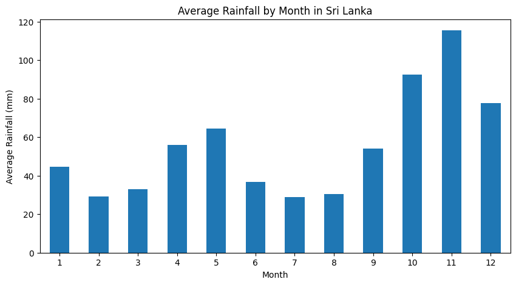
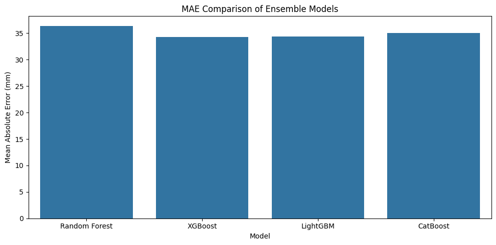
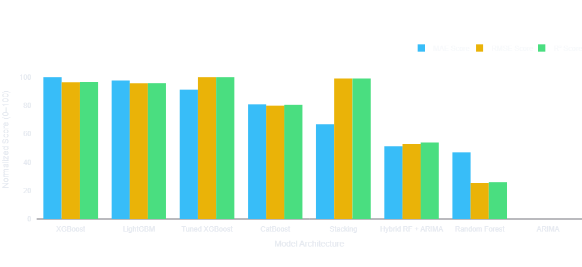
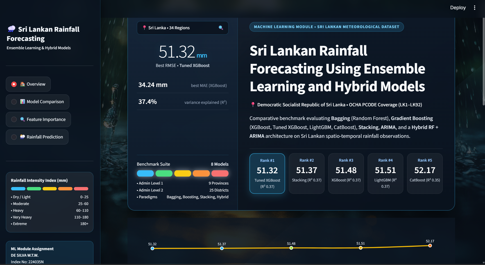

# Sri Lankan Rainfall Forecasting Using Ensemble Learning and Hybrid Models

## Project Overview

This project explores the application of ensemble learning techniques and hybrid models for forecasting rainfall across Sri Lanka.

Historical rainfall observations from different geographical areas are used to train and evaluate multiple machine learning models. The project compares individual ensemble algorithms (**Bagging** and **Gradient Boosting**), a **Stacking** ensemble, a statistical **ARIMA** baseline, and a **Hybrid Random Forest–ARIMA** model to identify their forecasting performance.

An interactive **Streamlit** dashboard is also developed to visualise model performance, explore feature importance, and generate next-period rainfall predictions for all 34 Sri Lankan provinces and districts.

---
## Live Dashboard:  [Sri Lankan Rainfall Forecasting Using Ensemble Learning and Hybrid Models](https://srilankanweatherensembleproject-zkfzvkmvbsvtvsmp7buyj2.streamlit.app/)
---
## Dataset

- **Source:** [Sri Lanka Rainfall Analysis Dataset](https://github.com/wethumlansakara/Sri-Lanka-Rainfall-Analysis)
- **Original data provider:** Humanitarian Data Exchange (HDX)
- **Geographical coverage:** 9 provinces (Admin Level 1: `LK1`–`LK9`) and 25 districts (Admin Level 2: `LK11`–`LK92`) in Sri Lanka
- **Time period:** 1981–2026 (~10-day dekadal observation intervals)
- **Number of observations:** 55,590 raw records (55,386 records after lag feature preprocessing)

The dataset contains historical rainfall measurements and administrative geographical identifiers across Sri Lanka.

---

## Exploratory Data Analysis

Exploratory analysis examined the distribution of rainfall values, missing records, observation intervals, and seasonal variations across Sri Lanka. Monthly aggregation highlights Sri Lanka's bimodal monsoon pattern, with peak rainfall occurring during the **Southwest Monsoon (May)** and the **Second Inter-Monsoon (October–November)**:



---

## Methodology

### 1. Data Exploration and Preprocessing
- Explored rainfall observations and geographical coverage across all 34 administrative units.
- Examined missing values and duplicate `(PCODE, date)` records.
- Sorted observations chronologically per geographical `PCODE` for time-series forecasting.
- Engineered 7 predictive features combining current and lagged rainfall (`rfh_current`, `rfh_lag_1`, `rfh_lag_2`, `rfh_lag_5`), target calendar `month`, and geographical identifiers (`PCODE`, `adm_level`).
- Applied one-hot encoding (`OneHotEncoder`) to categorical geographical features inside a preprocessing pipeline.

### 2. Forecasting Approach

The project uses historical rainfall observations and lag features to predict rainfall in the next available observation period ($t + 1$).

A chronological 80:20 training and testing split (split at `2017-05-11`, yielding **44,302 training records** and **11,084 testing records**) was used to preserve temporal order and prevent future data leakage during training.

### 3. Models Implemented

The following eight approaches were implemented and compared:

- **Random Forest** (Bagging)
- **XGBoost** (Gradient Boosting)
- **LightGBM** (Gradient Boosting)
- **CatBoost** (Gradient Boosting)
- **Stacking Ensemble** (Out-of-fold `TimeSeriesSplit` predictions combined via a `Ridge` meta-learner)
- **ARIMA** (`(1, 0, 1)` per-region statistical baseline)
- **Hybrid Random Forest–ARIMA** (`50% Random Forest + 50% ARIMA` weighted forecast)
- **Tuned XGBoost** (Hyperparameter-tuned on a chronological validation split)

### 4. Model Evaluation

Models were evaluated on the unseen test set using:

- **Mean Absolute Error (MAE)**
- **Root Mean Squared Error (RMSE)**
- **Coefficient of Determination (R²)**

---

## Model Performance & Interpretation

| Model | Paradigm | MAE | RMSE | R² |
|---|---|---:|---:|---:|
| Random Forest | Bagging | 36.4007 | 54.4462 | 0.2949 |
| XGBoost | Gradient Boosting | **34.2437** | 51.4821 | 0.3696 |
| LightGBM | Gradient Boosting | 34.3427 | 51.5076 | 0.3690 |
| CatBoost | Gradient Boosting | 35.0272 | 52.1662 | 0.3527 |
| Stacking | Stacking Ensemble | 35.5968 | 51.3663 | 0.3724 |
| ARIMA | Statistical Baseline | 38.3072 | 55.5040 | 0.2673 |
| Hybrid RF–ARIMA | Hybrid (RF + ARIMA) | 36.2229 | 53.2939 | 0.3245 |
| Tuned XGBoost | Gradient Boosting | 34.6044 | **51.3243** | **0.3735** |

### Ensemble Models MAE Comparison


### Normalized Multi-Metric Comparison Across All 8 Models


**Key findings & model interpretations:**
- **XGBoost** achieved the lowest **MAE** (`34.2437 mm`), while **Tuned XGBoost** achieved the lowest **RMSE** (`51.3243 mm`) and highest **R²** (`0.3735`).
- **Gradient Boosting vs. Random Forest (Bagging):** Sequential gradient boosting models (XGBoost, LightGBM, CatBoost) outperformed Random Forest across every metric because iterative residual fitting captures sharp monsoon rainfall transitions more effectively than variance-averaging parallel trees.
- **Stacking Ensemble:** Combining diverse tree learners through a `Ridge` meta-regressor achieved the second-best RMSE (`51.3663`) and R² (`0.3724`).
- **Hybrid RF–ARIMA:** Combining Random Forest with ARIMA improved upon both standalone ARIMA (`RMSE 55.5040 → 53.2939`) and standalone Random Forest (`RMSE 54.4462 → 53.2939`), though tuned gradient boosting remained strongest for multi-region tabular lag forecasting.
- **Tabular vs. Unstructured Data:** Tree ensembles excel on structured tabular meteorological features (lags, administrative codes, calendar month) with fast inference and clear feature attribution, whereas unstructured image or text data require deep neural networks (CNNs/Transformers).

---

## Interactive Dashboard

The Streamlit dashboard (`dashboard/app.py`) provides four interactive modules:

1. **Overview:** Project summary, best model KPIs, top-5 RMSE trajectory, and full benchmark comparison table.
2. **Model Comparison:** Interactive metric selection (`RMSE`, `MAE`, `R²`), normalized multi-metric view, and model filtering.
3. **Feature Importance:** Top-N feature importance visualization and driver interpretation for Tuned XGBoost.
4. **Rainfall Prediction:** User-friendly Province/District selector (automatically mapping all 34 Sri Lankan areas to their verified `PCODE` and `adm_level`), rainfall intensity index gauge, and lag-to-forecast trend visualization.

### Dashboard Overview


### Next-Period Rainfall Prediction


---

## Project Structure

```text
SriLankan_Weather_Ensemble_Project/
│
├── dashboard/
│   ├── app.py
│   └── assets/
│       └── rain_bg.jpg
│
├── data/
│   └── raw/
│       └── weather.csv
│
├── notebooks/
│   ├── 01_Dataset_Exploration.ipynb
│   └── models/
│       ├── catboost.pkl
│       ├── final_model_comparison.csv
│       ├── hybrid_rf_arima.pkl
│       ├── lightgbm.pkl
│       ├── random_forest.pkl
│       ├── stacking_model.pkl
│       ├── tuned_xgboost.pkl
│       └── xgboost.pkl
│
├── results
├── .gitignore
├── README.md
└── requirements.txt
```

## Installation and Execution

### 1. Clone the repository

```bash
git clone YOUR_GITHUB_REPOSITORY_URL
cd SriLankan_Weather_Ensemble_Project
```

### 2. Create a virtual environment

```bash
python -m venv venv
```

### 3. Activate the virtual environment

Windows PowerShell:

```powershell
.\venv\Scripts\Activate.ps1
```

### 4. Install dependencies

```bash
pip install -r requirements.txt
```

### 5. Run the Streamlit dashboard

```bash
streamlit run dashboard/app.py
```

The dashboard will open in your browser.

## Technologies Used

- Python
- Pandas and NumPy
- Scikit-learn
- XGBoost
- LightGBM
- CatBoost
- Statsmodels
- Matplotlib and Seaborn
- Plotly
- Streamlit
- Jupyter Notebook

## Generative AI Usage

Generative AI tools were used for assistance with selected aspects of development, including code troubleshooting, explanations, and dashboard UI improvements. The dataset analysis, model implementation, experimentation, evaluation, and interpretation were carried out as part of this project.

## Author

Tharushi De Silva
